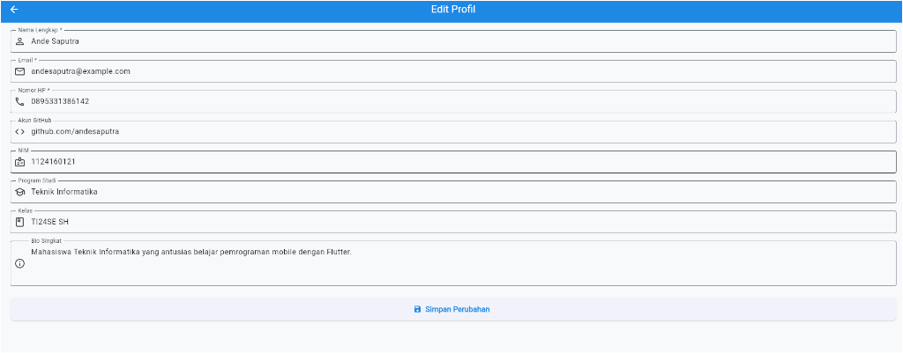

# Ujian Tengah Semester (UTS) – Pemrograman Mobile (Flutter)

## Identitas Mahasiswa
- **Nama:** Ande Saputra
- **NIM:** 1124160121
- **Kelas:** TI24SE SH
- **Program Studi:** Software Engineering

---

## 📺 Video Presentasi (Soal 2)
[Klik di sini untuk menonton video presentasi YouTube](MASUKKAN_LINK_YOUTUBE)

---

## 📸 Screenshot Aplikasi (Soal 2)

### 1. Halaman Utama & Drawer
Menampilkan halaman utama aplikasi beserta menu navigasi (Drawer).


### 2. Halaman Edit Profil (Form Validation)
Menampilkan halaman edit profil yang dilengkapi validasi input form.



### 3. Halaman Tentang Saya
Menampilkan informasi profil dan deskripsi singkat mengenai diri saya.


---

## ⚙️ Cara Menjalankan Proyek

Pastikan Flutter dan Dart sudah terinstal di perangkat.

1. Clone repository ini:
   ```bash
   git clone URL_REPOSITORY
   ```

2. Masuk ke direktori proyek:
   ```bash
   cd nama_project
   ```

3. Instal dependencies:
   ```bash
   flutter pub get
   ```

4. Jalankan aplikasi:
   ```bash
   flutter run
   ```

---

## 🛠️ Teknologi
- Flutter
- Dart
