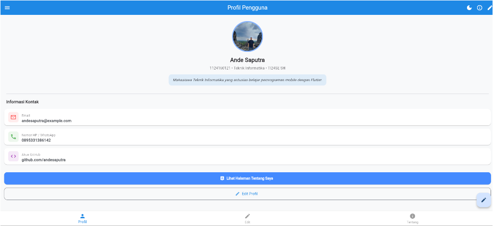
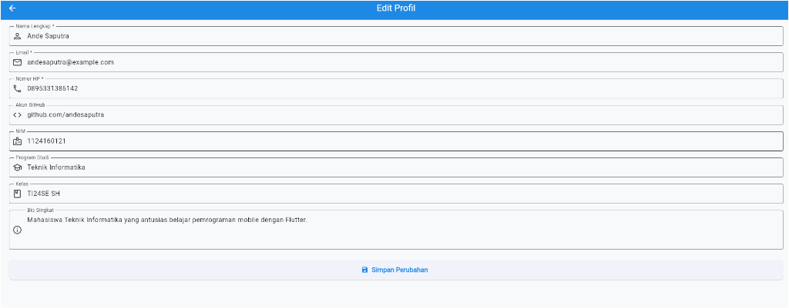
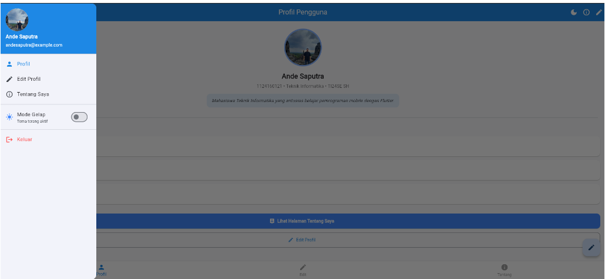

# Soal 2 - Aplikasi Profil Pengguna (Flutter)

Aplikasi Flutter profil pengguna sederhana yang mencakup fitur autentikasi login, tampilan profil pengguna, dan edit profil.

---

## 👤 Identitas Mahasiswa
- **Nama:** Ande Saputra
- **NIM:** 1124160121
- **Kelas:** TI24SE SH
- **Program Studi:** Software Engineering
- **Repository GitHub:** [https://github.com/1124160121-byte/uts-pml-1124160121.git](https://github.com/1124160121-byte/uts-pml-1124160121.git)

---

## 🎥 Link Video Demo YouTube
Tonton video demo aplikasi di YouTube melalui link berikut:  
🔗 **[Video Demo Aplikasi di YouTube](https://youtu.be/RhfNi2fFEPs?si=9EF4kJz65q5RsQ8x)**

---

## 📱 Screenshot Aplikasi

Berikut adalah dokumentasi tampilan layar aplikasi:

### 1. Gambar Profil
Menampilkan halaman profil utama pengguna lengkap dengan avatar, identitas mahasiswa, informasi kontak, dan aksi navigasi.



### 2. Edit Profil
Menampilkan formulir pengubahan data profil lengkap dengan validasi input interaktif.



### 3. Daftar Fitur
Menampilkan panel navigasi samping (Drawer) yang memuat menu navigasi, switch tema Gelap/Terang, dan fitur-fitur aplikasi.



---

## ✨ Daftar Fitur & Arsitektur
1. **Autentikasi / Login**: Form login dengan validasi input, indikator loading, dan navigasi `pushReplacement`.
2. **Halaman Profil**: Menampilkan data profil pengguna (nama, foto/avatar, email, kontak telepon, GitHub) dengan widget modular `InfoTile`.
3. **Scaffold Lengkap**: Dilengkapi dengan `drawer` (UserAccountsDrawerHeader + menu navigasi), `bottomNavigationBar`, dan `floatingActionButton`.
4. **Edit Profil**: Form validasi interaktif yang mengembalikan data hasil suntingan kembali ke halaman profil secara langsung via `setState()`.
5. **Halaman Tentang Saya**: Berisi ringkasan pengembang, daftar keahlian/hobi (dengan chip dan ikon), serta riwayat pendidikan.
6. **Tema Terang & Gelap (Light/Dark Theme)**: Palet warna custom sendiri dan switch mode tema langsung yang mengubah `themeMode` secara instan di AppBar dan Drawer.
7. **Identitas Aplikasi Android**: Konfigurasi `android:label="Profil Ande"` di `AndroidManifest.xml`.

---

## 💾 Manajemen Data & Dependensi Paket
- **Penyimpanan Data**: Sesuai ketentuan, data disimpan secara lokal di dalam **memori (in-memory state)** menggunakan mekanisme `StatefulWidget`, `setState()`, dan `Navigator.pop(context, updatedProfile)` antar layar tanpa memerlukan server atau database eksternal.
- **Paket Dependensi**: Proyek ini dibangun sepenuhnya menggunakan paket bawaan **Flutter SDK** (`flutter`) dan paket ikon bawaan **`cupertino_icons`**, tanpa ketergantungan paket eksternal pihak ketiga tambahan. Hal ini memastikan aplikasi sangat ringan, stabil, tidak rawan *breaking changes*, serta kompatibel penuh dijalankan di berbagai perangkat/platform.

---

## 🚀 Cara Menjalankan Aplikasi

Pastikan Flutter SDK sudah terpasang di sistem Anda. Buka terminal pada folder proyek ini, lalu jalankan perintah:

1. Unduh seluruh dependensi paket:
   ```bash
   flutter pub get
   ```

2. Jalankan aplikasi ke emulator / perangkat:
   ```bash
   flutter run
   ```
